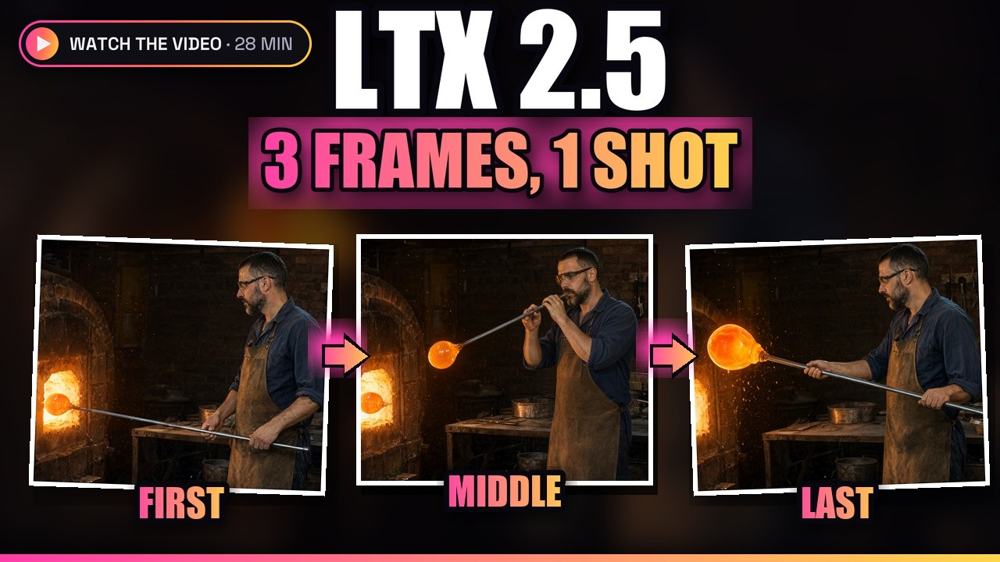
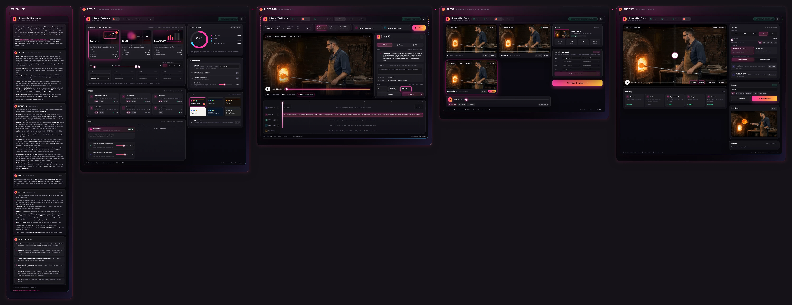

# Stubelius Ultimate LTX 2.5

[](https://youtu.be/0aRAocXqhBE)

**▶ [Watch the 2.1 video on YouTube](https://youtu.be/0aRAocXqhBE)** (28 min). It goes through all four windows, from
the first setting to the finished video, with first, middle and last frames in one shot, seeds side by side, a 2K
finish and a retake of one moment.

The LTX 2.5 Director timeline node plus **Stubelius Ultimate LTX**: one LTX 2.5 workflow for ComfyUI, in four
windows. **Setup** decides **how** the seeds are rendered (Full size, Draft or Low VRAM, the models, the speed-ups).
The **Director** holds **what the video is**: frames, prompts, motion, sound and characters on one timeline.
**Seeds** plays 1–4 full seeds with sound side by side, you pick the winner, and only the winner gets finished in
**Output** (resolution up to 4K, frame rate, upscaler).

Install steps, settings and RTX 5090 render times: [the Stubelius Ultimate LTX 2.5 guide](https://stuubzzz.studio/blog/ltx-2-5-director-comfyui-multishot-timeline/).

<div align="center">
<a href="docs/ultimate_ltx_workflow.webp?raw=true"></a>
<br>
<em>The workflow after a render of the glassblower: three seeds, seed 3 picked and finished at 2K. Click the image to
see it full size.</em>
</div>

## What's new in 2.1

- **Four windows**: Setup, Director, Seeds and Output, six looks, a step bar on top of every window and a **How to
  use** window next to them.
- **The Director as a window**: keyframes (the last frame lands on the video's real last frame), prompts cut into
  segments, motion, audio and the Cast for Licon MSR characters, all on one timeline.
- **Seeds**: every seed side by side and in sync, solo, A/B split and full size. Pick the winner, or hunt new seeds.
- **Output**: the finish settings (up to 4K, up to 120 fps with RIFE, DLSS5 + Color Lock or RTX VSR) next to a
  split view with a loupe, the export and the last frame.
- **Finish the winner** is one button in Seeds: only the finish runs. If the settings changed since the seeds, it
  asks before it renders them again.
- **Fixes**: a retake covers exactly the frames you set (it could start early), and the Director's Size field
  shows the size the video will really have.

To get the windows, open the example workflow again (below). A workflow from before opens the Director in its
classic editor, with **Show as window** under it.

## Stubelius Ultimate LTX

The workflow is in [`example_workflows/Stubelius_Ultimate_LTX.json`](example_workflows/Stubelius_Ultimate_LTX.json).
Once the pack is installed it also appears in ComfyUI under **Workflow → Browse Templates → Stubelius-Ultimate-LTX2.5**.

It opens as four windows, left to right: **1 Setup → 2 Director → 3 Seeds → 4 Output**, with a step bar
in each to jump between them. The HOW TO USE window next to them explains every one. The small nodes the
windows edit sit behind them; move a window to reach one.

| Window | Node | Job |
|---|---|---|
| **Setup** | **Stubelius LTX Setup**, **Seed Samplers**, **Models**, **Theme** | How the seeds are rendered (Full size, Draft or Low VRAM), 1–4 seeds, a sampler per seed, the checkpoint (safetensors or GGUF), distill / IC / MSR / global LoRAs, text encoder, VAEs, latent upscaler, attention, memory options, live preview, the colour theme |
| **Director** | **LTX Director CS (2.5)** | The timeline: segments with prompts, pictures and clips, keyframes, motion clips (IC-LoRA), audio, references (Licon MSR), size, length, frame rate |
| **Seeds** | **Stubelius LTX Seed Previews** | Every seed side by side, in sync, with its sound; pick the winner |
| **Output** | **Stubelius LTX Finish**, **Output** | The finish of the winner: refine (half-size seeds only), final resolution (native up to 4K), final fps through RIFE, RTX VSR or DLSS5 + Color Lock, export |

The other nodes: **Stubelius LTX Seeds** renders the seeds at the first-pass scale, with sound;
**Stubelius LTX Live Preview** shows Seeds and Finish while they sample; **Stubelius LTX RIFE to FPS** and
**Stubelius LTX Color Lock** convert the frame rate with clean hard cuts and restore the original colours
after DLSS5.

**Render** in the Director renders the seeds and stops; pick the winner in Seeds (or in the Director),
then **Finish the winner**. Only the finish runs; the seeds come from cache.

Every node and script in this pack has its own name, so it installs next to Stubelius Ultimate H3
(MiniMax) without clashes.

### Other node packs

Load the workflow and use Manager → **Install Missing Custom Nodes**, or install them yourself:

| Pack | Needed for |
|---|---|
| [ComfyUI-VideoHelperSuite](https://github.com/Kosinkadink/ComfyUI-VideoHelperSuite) | video outputs |
| [ComfyUI-KJNodes](https://github.com/kijai/ComfyUI-KJNodes) | live preview, Sage attention and the low-VRAM options |
| [Nvidia RTX nodes](https://github.com/Comfy-Org/Nvidia_RTX_Nodes_ComfyUI) | RTX VSR upscaling (NVIDIA RTX GPU) |
| [ComfyUI-Frame-Interpolation](https://github.com/Fannovel16/ComfyUI-Frame-Interpolation) | final fps above the Director's (RIFE) |
| [ComfyUI-DLSS5-Enhancer](https://github.com/Blueforcer/ComfyUI-DLSS5-Enhancer) | DLSS5 upscaler |
| [ComfyUI-GGUF](https://github.com/city96/ComfyUI-GGUF) | GGUF models |

ComfyUI-DLSS5-Enhancer also needs its runtime. Its `install_runtime.py` asks GitHub for a release tag
that doesn't exist (404), so give it the v3.0 download. From the `ComfyUI_windows_portable` folder:

```
python_embeded\python.exe ComfyUI\custom_nodes\ComfyUI-DLSS5-Enhancer\install_runtime.py --url https://github.com/Merserk/dlss5-visual-enhancer/releases/download/v3.0/DLSS.5.Visual.Enhancer.v3.0.zip
```

Then restart ComfyUI. Stay on v3.0: the later Visual Enhancer releases are a rebuilt app without the
files the node runs on (its worker, ReShade and the RenoDX add-on), and their DLSS 5 model is the same.
Install the node only from the link above; a copy of it on GitHub ships malware.

### Models

Official files from [Lightricks/LTX-2.5](https://huggingface.co/Lightricks/LTX-2.5):

| Folder | File |
|---|---|
| `models/diffusion_models` | [`ltx-2.5-22b-distilled-transformer-comfy-int8-convrot.safetensors`](https://huggingface.co/Lightricks/LTX-2.5/resolve/main/diffusion_models/ltx-2.5-22b-distilled-transformer-comfy-int8-convrot.safetensors) |
| `models/text_encoders` | [`gemma4-12b-with-proj-ltx-2.5-comfy-int8-convrot.safetensors`](https://huggingface.co/Lightricks/LTX-2.5/resolve/main/text_encoders/gemma4-12b-with-proj-ltx-2.5-comfy-int8-convrot.safetensors) |
| `models/vae` | [`ltx-2.5-video-vae-bf16.safetensors`](https://huggingface.co/Lightricks/LTX-2.5/resolve/main/vae/ltx-2.5-video-vae-bf16.safetensors), [`ltx-2.5-audio-vae-bf16.safetensors`](https://huggingface.co/Lightricks/LTX-2.5/resolve/main/vae/ltx-2.5-audio-vae-bf16.safetensors) |
| `models/latent_upscale_models` | [`ltx-2.5-latent-spatial-upscaler-x2-bf16-1.0.safetensors`](https://huggingface.co/Lightricks/LTX-2.5/resolve/main/latent_upscale_models/ltx-2.5-latent-spatial-upscaler-x2-bf16-1.0.safetensors) |
| `models/vae` | optional live preview: a tiny LTX VAE such as `taeltx2_3.safetensors`, picked as "live preview" on the Models node |
| `models/loras` | optional, for the Director's Licon MSR reference option: Licon's LTX 2.5 MSR LoRA ([`LTX-2.5-Licon-MSR-V2.safetensors`](https://huggingface.co/LiconStudio/LTX-2.5-Multiple-Subject-Reference/resolve/main/LTX-2.5-Licon-MSR-V2.safetensors); V1 also works), picked as "msr lora" on the Models node. The LTX 2.3 MSR LoRAs don't work on 2.5 |

2.5 needs the Gemma 4 text encoder and will not load a 2.3 one. RIFE downloads its checkpoint the
first time a final fps above the Director's is used.

Developed on an RTX 5090 (32 GB). With less VRAM, turn on the Models node's memory options.

The video decode sizes itself to the free VRAM before it starts. When a clip doesn't fit at the
decode tile size, it steps the tile down and still decodes every frame in one pass; only below
256 px does it decode in crossfaded chunks. It doesn't wait for an out-of-memory error: on
Windows, NVIDIA's driver lets an allocation past the card's VRAM spill into system RAM
instead, so that error never comes. The spilled decode crawls and can reset the driver.

To get a clean out-of-memory error from the rest of ComfyUI too, open NVIDIA Control Panel →
Manage 3D Settings → Program Settings. Pick ComfyUI's `python.exe` and set **CUDA - Sysmem
Fallback Policy** to **Prefer No Sysmem Fallback**.

## The Director

### The Director window

In Stubelius Ultimate LTX the Director is a window: a preview of the latest seeds, an inspector for
what you pick and a timeline with keyframes, prompts, motion, audio and references. A Director from an
older workflow opens in the classic editor, with **Show as window** under it; **Settings → Classic
editor** in the window goes back. Both write the same timeline, so a timeline renders the same from
either. Chunk render, packed timelines and timeline files are in the classic editor.

### What works

- Timeline with image, text, audio and video segments
- Prompt zones and prompt relay
- Image anchors and end frames (in the window: Last frame on the Keyframes lane; in the classic editor:
  right click a segment → "pin to last frame")
- Multiple keyframes
- Retake a part of a video
- Chunk render for long videos, with audio (classic editor)
- Packed timelines (save a timeline with its assets embedded; classic editor)

### Reference images (Licon MSR)

The reference features are on in this build (`REFERENCE_FEATURES` in `ltx_director.js` and
`ltx_director.py`). **Licon MSR** runs on the Stubelius MSR25 engine made for LTX 2.5: each
character or ingredient image becomes a slot-embedded reference, as in
[liconstudio/ComfyUI-LTX2.5-MSR](https://github.com/liconstudio/ComfyUI-LTX2.5-MSR).

In Stubelius Ultimate LTX, choose Licon MSR as the Director's reference option and pick the
LTX 2.5 MSR LoRA on the Models node. It is used in both passes:

- **Seeds (first pass):** the Models node's MSR LoRA strength, and the Director's reference strength.
- **Refine (second pass):** the Output node's refine MSR LoRA strength and refine MSR reference.
  About 0.4 keeps the detail without the references repainting the opening. 0 means the
  Director's value.

Ghost Mask and the `@ref` sheets were made for LTX 2.3's behaviour.

### Older nodes

**Stubelius LTX Seed Hunt** and **Stubelius LTX Refine (Pass 2)** are still registered, so
workflows built with them keep loading. The Ultimate LTX nodes replace them.

## Install

Clone into your ComfyUI custom nodes folder:

```
cd ComfyUI/custom_nodes
git clone https://github.com/stuubszzz/Stubelius-Ultimate-LTX2.5.git
```

Then restart ComfyUI. To update, `git pull` in that folder (or Manager → Update All) and restart.
If the update fails on an install made before October 2026, delete the pack's folder and clone it again.

It can stay installed next to WhatDreamsCost's original pack and the LTX 2.3 pack (both under Credits).
The nodes here have their own names (`LTXDirectorCS25`, `LTXDirectorGuideCS25` and so on) and are
listed as *… CS (2.5)* in the node menu.

## Credits

Based on [WhatDreamsCost's LTX Director](https://github.com/WhatDreamsCost/WhatDreamsCost-ComfyUI)
— the original node this is forked from.

This is the **LTX 2.5** build. If you are on LTX 2.3, use
[WhatDreamsCost-CSGlide](https://github.com/CGlide/WhatDreamsCost-CSGlide) instead.

LTX models by [Lightricks](https://github.com/Lightricks).

Development assistance from Claude (Anthropic).
